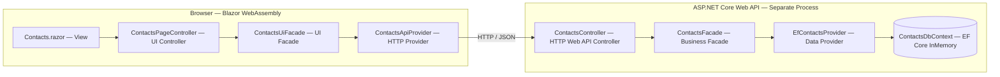
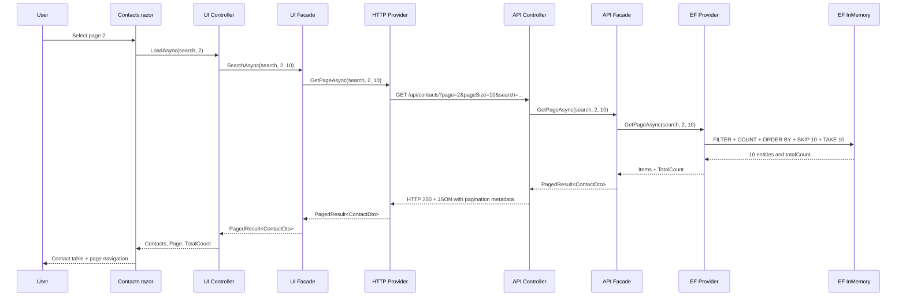
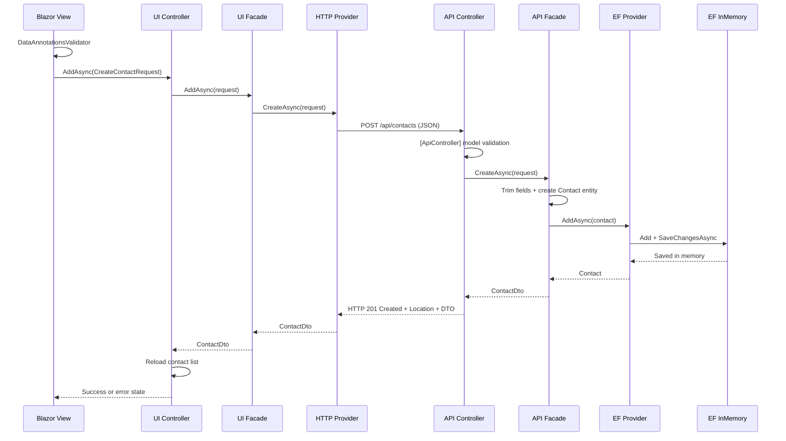

# Application Architecture

## 1. Purpose and design approach

This PoC explicitly demonstrates the **Controller → Facade → Provider** pattern in both the frontend and backend. Blazor WebAssembly runs in the browser, so its controller is **not** an instance of `Microsoft.AspNetCore.Mvc.ControllerBase`. Instead, it is an ordinary C# **presentation/application controller** that manages UI state. The backend uses an actual HTTP Web API controller.

## 2. End-to-end component diagram

Both the Web and API projects reference `AddressBook.Contracts` to share the same DTO types. **The Web project does not reference the API project**, and **the browser never accesses `DbContext` directly**.

## 3. GET request flow — server-side pagination

The response includes `items`, `page`, `pageSize`, `totalCount`, and `totalPages`. Filtering and stable sorting by `LastName`, `FirstName`, and `Id` occur before `Skip`/`Take`. A new search resets the UI to page 1. The API validates `page` and `pageSize` (`page >= 1` and `1 <= pageSize <= 100`).

## 4. POST request flow — create a contact

## 5. Responsibilities by layer

| Layer | Frontend (Web) | Backend (API) |
|---|---|---|
| View | `Pages/Contacts.razor`: user interface, form events, and validation | No MVC view; REST endpoints return JSON |
| Controller | `Controllers/ContactsPageController.cs`: UI state, loading indicators, errors, and orchestration | `Controllers/ContactsController.cs`: routing, HTTP status codes, and incoming parameters |
| Facade | `Facades/ContactsUiFacade.cs`: use-case entry point for the UI | `Facades/ContactsFacade.cs`: business orchestration and DTO mapping |
| Provider | `Providers/ContactsApiProvider.cs`: HTTP requests, JSON, and URL encoding | `Providers/EfContactsProvider.cs`: EF Core queries and persistence operations |
| Data | Shared DTOs in `AddressBook.Contracts` | `Models/Contact.cs` and `Data/ContactsDbContext.cs` |

### Why are both facade implementations relatively small?

This is intentional. The PoC focuses on **separation of responsibilities and testable interfaces**, rather than introducing artificial business logic. In a larger application, the UI facade might coordinate multiple API providers; the backend facade could enforce domain rules, manage transactions and authorization decisions, or orchestrate multiple data sources.

### Dependency injection and service lifetimes

- Both projects register their service interfaces with `AddScoped` in `Program.cs`.
- On the server, `DbContext` is **scoped to an HTTP request**.
- In Blazor WebAssembly, a `Scoped` service effectively lives for the lifetime of the current browser-side application instance.
- The InMemory database exists only in the API process; it is not a SQL database. Restarting the API restores seed data.

### Validation and technical constraints

- `POST` requests are validated both in the browser (DataAnnotations) and independently on the backend (`[ApiController]`).
- The HTTP provider checks response status codes and throws for failed requests; the UI controller presents errors to the user.
- CORS permits only the configured local Blazor origin.
- Read-only queries use `AsNoTracking()`.
- `EfContactsProvider` uses `IQueryable`, `CountAsync`, `OrderBy`, `Skip`, `Take`, and `AsNoTracking` to filter and paginate before materializing results.
- There is no automatic retry, authentication, or disk-based persistence.

## 6. Alternative hosting options: Blazor Server / Blazor Web App

This example uses a **standalone Blazor WebAssembly client** to make the HTTP boundary explicit. In a Blazor Server application, a provider might invoke a server-side service directly, so an HTTP boundary would not necessarily exist. That would make the requested pattern less transparent for demonstration purposes.
